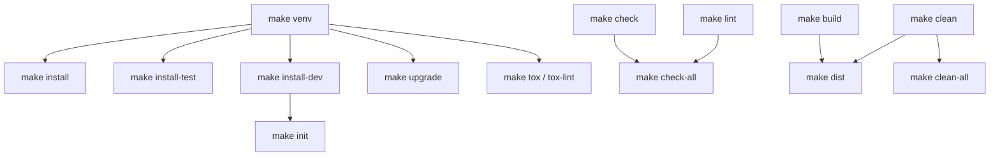

# Makefile Analysis & Reference Guide

This document provides a complete breakdown of the [`Makefile`](file:///home/jksingh/lifelib/Makefile) in the `lifelib` repository and what each section and target does.

---

## 1. Configuration Variables & OS Detection (Lines 6–28)

At the top of [`Makefile`](file:///home/jksingh/lifelib/Makefile#L6-L28), the script sets up paths, OS-specific variables, and terminal colors:

- **Python & Virtual Environment Paths**:
  - `PYTHON := python3` — System Python executable used to create the virtual environment.
  - `VENV := venv_lifelib` — Directory name for the local virtual environment.
  - `BIN := $(VENV)/bin` — Binary folder inside the virtual environment.
  - `PYTHON_VENV := $(BIN)/python` and `PIP := $(BIN)/pip` — Point directly to the virtual environment's `python` and `pip` so targets can run without requiring you to manually activate the venv first.
- **Cross-Platform Activation Check**:
  - Checks `ifeq ($(OS),Windows_NT)` to set `ACTIVATE` to `venv_lifelib/Scripts/activate` on Windows or `venv_lifelib/bin/activate` on Linux/macOS.
- **ANSI Color Codes**:
  - Defines `BLUE`, `GREEN`, `YELLOW`, `RED`, and `NC` (No Color) for formatted terminal output.
- **Default Goal**:
  - `.DEFAULT_GOAL := help` — Running `make` with no arguments automatically executes `make help`.

---

## 2. Breakdown of Makefile Targets by Category

### A. Help & Environment Inspection
| Target | Lines | What It Does |
| :--- | :--- | :--- |
| `make help` | [L30-L44](file:///home/jksingh/lifelib/Makefile#L30-L44) | Parses the `Makefile` using `grep` and `awk` to automatically list every target that has a `##` description comment, along with usage examples. |
| `make info` | [L153-L171](file:///home/jksingh/lifelib/Makefile#L153-L171) | Displays system Python path/version, checks whether `venv_lifelib` exists, and if so, prints its Python version and runs `pip list` to show all installed packages. |
| `make shell` | [L173-L176](file:///home/jksingh/lifelib/Makefile#L173-L176) | Sources the `venv_lifelib` activation script and spawns an interactive subshell (`exec $(SHELL)`) with the virtual environment active. |

---

### B. Virtual Environment & Dependency Installation
All installation targets depend on `venv`, meaning they will automatically create `venv_lifelib` if it doesn't exist yet.

| Target | Lines | What It Does |
| :--- | :--- | :--- |
| `make venv` | [L46-L57](file:///home/jksingh/lifelib/Makefile#L46-L57) | Checks if `venv_lifelib/` exists; if not, runs `python3 -m venv venv_lifelib` and prints activation instructions. |
| `make install` | [L58-L62](file:///home/jksingh/lifelib/Makefile#L58-L62) | **Production/Runtime install**: Upgrades `pip`, `setuptools`, and `wheel`, then runs `pip install -e .` (installs `lifelib` in editable mode with only `modelx>=0.32`). |
| `make install-test` | [L76-L80](file:///home/jksingh/lifelib/Makefile#L76-L80) | **Test install**: Runs `pip install -e ".[test]"` to install runtime dependencies plus `pytest`, `pytest-cov`, `pytest-xdist`, `pandas`, `numpy`, and `openpyxl`. |
| `make install-dev` | [L64-L75](file:///home/jksingh/lifelib/Makefile#L64-L75) | **Development install**: Runs `pip install -e ".[dev]"` to install runtime + test dependencies plus code quality tools (`flake8`, `black`, `isort`). |
| `make init` | [L188-L202](file:///home/jksingh/lifelib/Makefile#L188-L202) | **Full onboarding shortcut**: Runs `install-dev` and prints a welcome banner with next-step commands. |
| `make upgrade` | [L82-L86](file:///home/jksingh/lifelib/Makefile#L82-L86) | Upgrades `pip`, `setuptools`, `wheel`, and all `[dev]` dependencies (`pip install --upgrade -e ".[dev]"`). |

---

### C. Testing & Multi-Environment Verification
| Target | Lines | What It Does |
| :--- | :--- | :--- |
| `make test` | [L88-L91](file:///home/jksingh/lifelib/Makefile#L88-L91) | Runs `pytest -v --cov=lifelib --cov-report=term-missing` to execute the test suite verbosely and display terminal line-coverage with missing lines. |
| `make test-cov` | [L93-L96](file:///home/jksingh/lifelib/Makefile#L93-L96) | Runs `pytest` with coverage and generates three report formats: terminal summary, XML (`coverage.xml`), and an interactive HTML report in `htmlcov/index.html`. |
| `make test-fast` | [L98-L101](file:///home/jksingh/lifelib/Makefile#L98-L101) | Runs `pytest -n auto -v` (using `pytest-xdist`) to parallelize tests across all available CPU cores without coverage overhead. |
| `make tox` | [L178-L181](file:///home/jksingh/lifelib/Makefile#L178-L181) | Installs `tox` into the venv and runs `tox` to execute tests across multiple Python versions as configured in [`tox.ini`](file:///home/jksingh/lifelib/tox.ini). |
| `make tox-lint` | [L183-L186](file:///home/jksingh/lifelib/Makefile#L183-L186) | Installs `tox` and runs only the `lint` environment (`tox -e lint`). |

---

### D. Code Quality (Linting & Formatting)
| Target | Lines | What It Does |
| :--- | :--- | :--- |
| `make lint` | [L103-L107](file:///home/jksingh/lifelib/Makefile#L103-L107) | Runs `flake8` in two passes on `lifelib/`: 1. **Strict pass**: Fails on syntax/undefined name errors (`E9,F63,F7,F82`). 2. **Style/Complexity pass**: Checks complexity (`--max-complexity=10`) and line length (`--max-line-length=127`) with `--exit-zero` (warnings only). |
| `make format` | [L109-L113](file:///home/jksingh/lifelib/Makefile#L109-L113) | Automatically formats Python files in `lifelib/` using `black` and sorts imports using `isort`. |
| `make check` | [L115-L119](file:///home/jksingh/lifelib/Makefile#L115-L119) | Dry-run formatting check: runs `black --check` and `isort --check-only` on `lifelib/` without modifying files. |
| `make check-all` | [L121-L122](file:///home/jksingh/lifelib/Makefile#L121-L122) | Combines `lint` and `check` into a single pre-commit verification command. |

---

### E. Packaging, Distribution & Cleanup
| Target | Lines | What It Does |
| :--- | :--- | :--- |
| `make build` | [L124-L128](file:///home/jksingh/lifelib/Makefile#L124-L128) | Installs the `build` package and runs `python -m build` to create source (`.tar.gz`) and wheel (`.whl`) distributions inside `dist/`. |
| `make dist` | [L130](file:///home/jksingh/lifelib/Makefile#L130) | Runs `clean` followed by `build` to ensure a fresh distribution build. |
| `make clean` | [L132-L146](file:///home/jksingh/lifelib/Makefile#L132-L146) | Deletes build artifacts (`build/`, `dist/`, `*.egg-info`), test/coverage caches (`.pytest_cache/`, `.coverage`, `htmlcov/`, `.tox/`), and recursively removes `__pycache__/` and `.pyc`/`.pyo`/`.pyd` files. |
| `make clean-all` | [L148-L151](file:///home/jksingh/lifelib/Makefile#L148-L151) | Runs `clean` and also deletes the entire `venv_lifelib/` virtual environment directory. |

---

## 3. Target Dependency Flow

